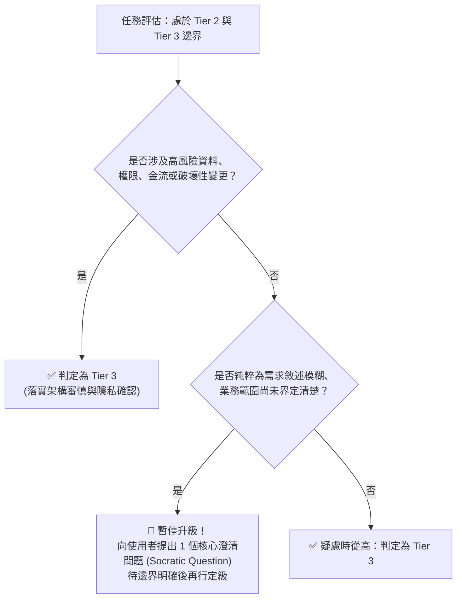

# Skill Conductor 調度矩陣與組合鏈手冊 (Dispatch Matrix & Chaining Guide)

本手冊為 `skill-conductor` 的底層決策對照表與典型場景標準作業程序 (SOP)。

---

## 一、 核心調度矩陣 (Dispatch Matrix)

| 任務領域 (Direction) | 風險訊號 (Risk Signals) | 推薦階梯 (Tier) | 核心調用技能組合 (Skill Chain) | 說明與邊界限制 |
| :--- | :--- | :--- | :--- | :--- |
| **Micro Bugfix / Refactor** | 純內部局部邏輯、無資料庫變更、極易回滾 | **Tier 1 (Micro)** | `/ponytail full` | 嚴禁調用外部重型工具與複雜規劃，直接輸出最小可行解。 |
| **UI / Styling / CSS** | 單組件視覺調整、A11y 對比修正、獨立設計風格 | **Tier 1 (Micro)** | `/ponytail full` + `frontend-design` (或 `ui-ux-pro-max`) | 依據主題設定視覺調性，避免模板化與無意義複雜度。 |
| **Presentation / Deck** | 橫向網頁 PPT、演講分享、瑞士風格簡報 | **Tier 1~2** | `guizang-ppt-skill` ➔ `/ponytail full` | 產出單一 HTML 翻頁簡報，內建演講者模式與 WebGL 效果。 |
| **Feature Development** | 單一明確功能、2~5 檔案、標準 CRUD | **Tier 2 (Standard)** | `[領域專長]` (或 `/gemini-web-copilot --task code`) ➔ `tdd` (紅綠循環/Vertical Slice) ➔ `/ponytail full` | 結合領域專長或 Gemini 網頁版百萬上下文生成落地代碼，經由 tdd 與 ponytail 精簡收斂。 |
| **Issue / PR Triage** | GitHub/Tracker 議題分類、驗證、撰寫 Agent Brief | **Tier 2 (Standard)** | `triage` ➔ `/grill-me` (若需釐清) ➔ `AGENT-BRIEF.md` | 結構化分類為 bug/enhancement 並進入狀態機流轉。 |
| **Architecture Deepening** | 代碼庫架構掃描、淺層模組收斂、深度模組重構 | **Tier 3 (Complex)** | `improve-codebase-architecture` + `codebase-design` ➔ `/grill-me` ➔ `/gemini-web-copilot --task code` | 產出可視化 HTML 診斷報告，對選定熱點進行 Deepening 代碼生成。 |
| **Browser Automation / E2E** | 網頁操作、自動化填表、截圖、探索式 QA 測試 | **Tier 2~3** | `agent-browser` ➔ `tdd` | 透過 CDP/無障礙樹精確操控網頁與 Electron 應用。 |
| **Session Handoff** | 當前任務或對話上下文壓縮、交接給下位 Agent | **Any Tier** | `handoff` ➔ 寫入 `%TEMP%` 臨時檔 | 梳理建議技能清單與產出物連結，脫敏後交接。 |
| **Discovery & Planning (核心流程)** | 需求規劃、方案探索、新功能啟動、架構選型 | **Tier 2~4** | `/find-skills` ➔ `/grill-me` (或 `grill-with-docs`) ➔ `domain-modeling` ➔ `plan` | **鐵律**：規劃階段優先啟動生態技能探索與蘇格拉底深度詰問。 |
| **API Integration / Mock** | 串接第三方 API 或建立 Mock | **Tier 2 (Standard)** | `api-patterns` ➔ `api-testing-observability-api-mock` ➔ `/ponytail` | 遵循 REST/GraphQL 規範與精簡落地。 |
| **Cross-Module Redesign** | 跨 2 個以上模組、涉及資料持久化或高併發 | **Tier 3 (Complex)** | `隱私確認門閘` ➔ `/gemini-web-copilot --task plan` ➔ `/gemini-web-copilot --task code` + `backend-architect` ➔ `tdd` ➔ `test` | 規劃至落地雙重賦能，需經使用者確認後調用外部分析與生成；否則降級至本地 `architecture`。 |
| **Deep RCA / Memory Leak** | 非同步超時卡死、記憶體洩漏、難題診斷 | **Tier 3 (Complex)** | `隱私確認門閘` ➔ `/gemini-web-copilot --task debug` ➔ `debug` ➔ `/ponytail full` | 收集錯誤日誌與嫌疑代碼進行深度因果推導與修復。 |
| **Epic / Greenfield System** | 需求模糊、架構草創、全套規範與多階段實施 | **Tier 4 (Epic)** | `/find-skills` ➔ `/grill-me` ➔ `隱私確認` ➔ `/gemini-web-copilot --task plan` ➔ `/gemini-web-copilot --task code` ➔ `speckit.*` 全流程 | Socratic 澄清 ➔ 百萬 Token 外部深度規劃與模組落地 ➔ 嚴格規格檢驗。 |

---

## 二、 邊界案例仲裁流程 (Boundary Arbitration Decision Tree)

當任務特徵介於 **Tier 2** 與 **Tier 3** 之間時，依循以下仲裁樹：



---

## 三、 技能鏈交接標準規範 (Chaining Handover SOP)

在多技能鏈接執行時，每一步驟均必須產生符合結構化標準的交接記錄：

### 1. 步驟執行規範
1. **前置檢驗**：在呼叫目標技能前，從 `references/skills_index.json` 驗證該技能確實存在。
2. **上下文傳遞**：將上一步產出之檔案路徑與核心假設寫入 Prompt 上下文。
3. **完成回報**：每一步結束時，必須列出本步產出物與下一步接手項目。

### 2. 步驟交接回報範本 (Handover Template)
```markdown
---
### 🔄 [技能鏈交接檢核 - 第 1 步完成]
- **當前執行技能**：`speckit.plan`
- ✅ **本步實體產出物**：
  - `docs/architecture_plan.md` (已定義模組邊界與介面簽名)
  - `src/types/sync.ts` (型別定義完成)
- 🧠 **共享架構假設**：採用樂觀鎖搭配 Redis 快取，暫不支援多區域分散式事務。
- 📌 **下一步接手技能**：`backend-architect` + `/ponytail full`
- 🎯 **下一步執行目標**：依據型別定義實作最小可行之資料同步核心。
---
```

---

## 四、 防護守衛實例

### 1. 循環調用阻斷 (Recursion Guard)
```text
🚨 架構違規：循環調用
檢測到技能鏈中意圖再次調用 [skill-conductor]。
為確保架構邊界清晰並杜絕無窮遞迴，執行已被強制終止。
```

### 2. 外部隱私授權門閘 (Privacy Gate)
```text
🧠 [Conductor 深度決策看板 - Tier 3/4]
- 擬調用技能：/gemini-web-copilot --task plan
- 外部發送範圍清單：
  * package.json (專案依賴)
  * src/services/auth.ts (認證介面與資料流)
  * 預計發送 Token 數：約 2,800 Tokens
- 安全聲明：已確認無硬編碼 API Key 或使用者隱私敏感資訊。
⚠️ 請確認是否授權將上述內容發送至 Gemini 網頁版進行深度推理分析？ (Y/N)
```

### 3. 顯式降級通報 (Explicit Degradation)
```text
⚠️ [降級通報]
- 原定方案：/gemini-web-copilot
- 降級原因：外部調試端口連線逾時 (60s Timeout)
- 當前切換至：本地精簡模式 (/ponytail full)
- 影響說明：略過百萬 Token 網頁版深度分析，直接基於本地既有模式實施最小可行變更。
```
